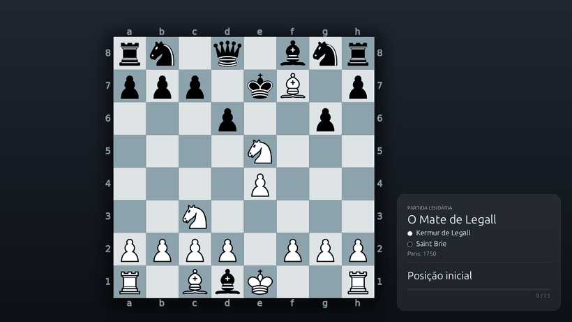
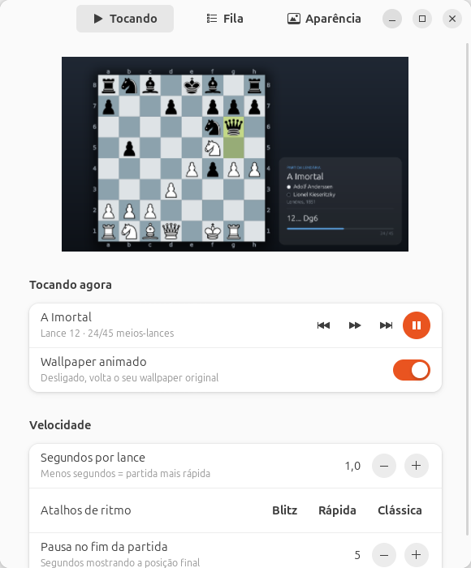
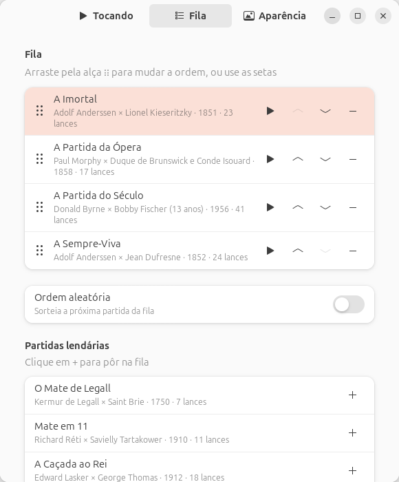

# ♞ Xadrez Wallpaper

Partidas lendárias de xadrez rodando no seu papel de parede, um lance de cada vez.



O seu wallpaper do GNOME vira um tabuleiro que reproduz partidas históricas
(A Imortal, a Partida do Século, a Ópera de Morphy…). No canto da tela aparece
qual partida está passando, quem jogou, o lance atual e comentários nos
momentos famosos.

## Instalação

### Ubuntu 24.04 ou mais novo (recomendado)

1. Baixe o arquivo **`xadrez-wallpaper_X.Y.Z_all.deb`** na página de
   [Releases](../../releases/latest).
2. Dê dois cliques nele e clique em **Instalar**. As dependências são baixadas
   automaticamente.
3. Abra **Xadrez Wallpaper** no menu de aplicativos e ligue a chave
   **Wallpaper animado**.

Ou, pelo terminal:

```bash
sudo apt install ./xadrez-wallpaper_*_all.deb
```

> Use `apt install`, não `dpkg -i`: só o `apt` baixa as dependências sozinho.

### Outras distros com GNOME (sem sudo)

```bash
git clone https://github.com/caio10012/xadrez-wallpaper
cd xadrez-wallpaper
./install.sh
```

O instalador copia tudo para `~/.local/share/xadrez-wallpaper`, então você pode
apagar a pasta clonada depois. Se faltar algum pacote do sistema, ele mostra o
comando exato para instalar.

## Como usar

O app de configuração tem três abas:

| Tocando | Fila |
|---|---|
|  |  |

- **Tocando**: prévia ao vivo, avançar e voltar lances, pausar e ligar ou desligar.
  Velocidade de 0,5 s a 10 min por lance, com atalhos Blitz, Rápida e Clássica.
- **Fila**: escolha as partidas e arraste pela alça ⋮⋮ (ou use as setas) para
  mudar a ordem. Também tem a opção de ordem aleatória.
- **Aparência**: tamanho do tabuleiro e do cartão, e três estilos de tabuleiro
  (Lichess, Chess.com e madeira).

Ao desligar, o seu wallpaper original volta.

Também dá para controlar pelo terminal:

```bash
xadrez-wallpaper proximo           # avança um lance
xadrez-wallpaper anterior          # volta um lance
xadrez-wallpaper proxima-partida   # pula para a próxima da fila
xadrez-wallpaper --help
```

## As partidas

Todas terminam em xeque-mate.

| Partida | Jogadores | Ano |
|---|---|---|
| O Mate de Legall | Legall × Saint Brie | 1750 |
| A Imortal | Anderssen × Kieseritzky | 1851 |
| A Sempre-Viva | Anderssen × Dufresne | 1852 |
| A Partida da Ópera | Morphy × Duque de Brunswick e Conde Isouard | 1858 |
| A Torre Intocável¹ | Steinitz × von Bardeleben | 1895 |
| Mate em 11 | Réti × Tartakower | 1910 |
| A Caçada ao Rei | Ed. Lasker × Thomas | 1912 |
| As Moedas de Ouro¹ | Levitsky × Marshall | 1912 |
| A Partida do Século | D. Byrne × Fischer (13 anos) | 1956 |

¹ O perdedor abandonou antes do mate. Depois do último lance jogado, o wallpaper
mostra o mate que viria, marcado como **análise**.

Quer sugerir uma partida? Abra uma issue com o PGN. Ela precisa terminar em mate.

## Requisitos

- GNOME 45 ou mais novo (Wayland ou X11)
- Python 3.10+, PyGObject, GTK 4.12+, libadwaita 1.4+, Pillow e librsvg

No Ubuntu 24.04, tudo isso já vem instalado ou é baixado pelo `.deb`.

## Desinstalar

- Se instalou pelo `.deb`: `sudo apt remove xadrez-wallpaper`, ou remova pela
  Central de Aplicativos.
- Se instalou pelo `install.sh`: rode `./uninstall.sh`.

O wallpaper original volta nos dois casos. As preferências ficam em
`~/.config/xadrez-wallpaper`; apague essa pasta se quiser.

## Para desenvolvedores

```bash
python3 -m xadrez_wallpaper testar   # valida as partidas e renderiza um quadro
python3 -m xadrez_wallpaper config   # abre o app direto do código
packaging/build-deb.sh               # gera dist/xadrez-wallpaper_<versão>_all.deb
```

**Publicar uma versão:** atualize `__version__` em `xadrez_wallpaper/__init__.py`,
crie uma tag e envie:

```bash
git tag v1.0.0
git push origin v1.0.0
```

O GitHub Actions monta o `.deb`, testa a instalação num Ubuntu 24.04 e
anexa o pacote na página de Releases.

Estrutura:

```
xadrez_wallpaper/
├── partidas.py   # catálogo de partidas (PGN + comentários)
├── render.py     # desenha o wallpaper (Pillow + librsvg)
├── daemon.py     # avança os lances e troca o wallpaper
├── app.py        # app de configuração (GTK4 + libadwaita)
└── vendor/chess  # python-chess embutido (não existe nos repositórios do Ubuntu)
```

## Licença

[GPL-3.0](LICENSE). Inclui o [python-chess](https://github.com/niklasf/python-chess)
de Niklas Fiekas (GPL-3.0), que também fornece o desenho das peças.
